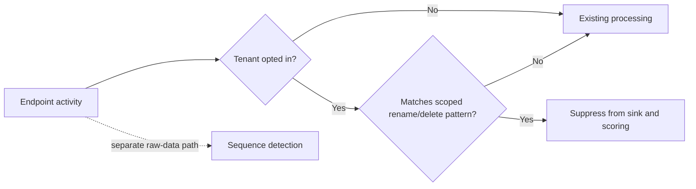

# Reducing temporary-file noise without losing useful signals

I worked on a customer problem in Insider Risk Management: endpoint activity
from temporary files was creating so much noise that it was harder to focus
on the activity people actually needed to investigate. The tempting fix was
to suppress anything that looked system-generated. That was also the risky
fix. An activity that looks routine in one context can still be important in
another, and the product could not reliably tell from application identity
alone whether the activity came from the system or a user.

I took the feature from investigating the data through designing the
behavior, aligning the teams, implementing the backend, and validating the
rollout. The important decision was to make the promise narrow: reduce
specific, well-understood temporary-file noise, not claim that every
system-looking event would disappear.

## Finding a useful boundary

I started by looking at the customer activity data and identifying which
patterns were responsible for most of the reported noise. The analysis
pointed to temporary-file rename and delete activity as the dominant
categories. That gave us a concrete place to start rather than a vague
request to "filter out system noise."

I wrote the proposal around the patterns, customer impact, user experience,
rollout options, limitations, and risks. We considered broader approaches,
but the product could not safely infer that all activity from a particular
application was harmless. Broad suppression could hide real user actions
and weaken the signals investigators depend on.

The design instead suppressed only matching rename and delete patterns for
tenants that explicitly enabled the feature. Other activity—including
copying, uploading, printing, emailing, and signals used in sequence
detection—continued through the existing paths. Sequence detection had its
own raw-data route, so the feature did not simply remove the underlying
activity everywhere.

That distinction shaped how I described the feature to stakeholders and
later to the customer: it reduced the agreed noise patterns, not every event
someone might consider temporary or system-generated.

## Getting the behavior agreed

This was as much a product and safety decision as a code change. I worked
through the proposal with product management, UX, content, Endpoint,
security/privacy, and engineering. We aligned on what the setting would
mean, where users would control it, which activity was in scope, and how to
roll it out without changing behavior for everyone.

The result was an opt-in experience through the product's global exclusion
controls. It stayed off by default. That gave us a way to enable the agreed
behavior for a preview tenant while keeping the existing behavior for other
customers.

The limitation was part of the design, not an afterthought: since we could
not reliably distinguish a system-created file operation from a
user-created one based only on the application, the suppression had to rely
on known patterns instead of a broad application-based rule.

## Carrying the setting through the system

The setting had to reach the backend paths that produced and scored
activity. I implemented the private-preview backend across three codebases:
the Kusto sink and scoring paths applied the same narrow predicate, while
the product setting was interpreted and made available to those paths.
I also added audit support so the behavior could be tracked rather than
leaving a hidden per-tenant switch with no operational history.

The predicate checked whether an activity matched the agreed temporary-file
rename/delete patterns and whether suppression was enabled for that tenant.
If either condition was false, the normal activity path remained unchanged.
I added focused utility tests and dispatcher integration tests to exercise
both the matching behavior and its connection to the processing pipeline.

Keeping the rule consistent across paths mattered. If one path suppressed
the activity while another continued to score it, the feature would be
confusing to customers and difficult for investigators to reason about.

## Preview and follow-up

The rollout was dark by default and tenant-gated. We enabled it for the
customer's private preview in June 2026, then checked the post-rollout
activity against the patterns we had agreed to suppress. The validation
showed that those matching rename/delete events were no longer appearing in
the scoped result.

The customer later pointed out other events that still looked
system-generated. I reviewed those examples against the agreed pattern set:
they did not match the feature we had shipped. There were further requests
for customer-specific path and recycle-bin exclusions, but those were
different rules with different risk and maintenance implications. I kept
that distinction clear instead of widening the original feature until
"temporary-file noise" meant an unbounded set of special cases.

## What I took from it

The hard part was not writing a predicate. It was deciding what the product
could safely promise, then making that promise consistent from analysis and
UX through backend behavior, rollout, and validation. Suppressing less
would have left the original noise problem mostly intact; suppressing more
could have hidden useful evidence. The narrow, opt-in boundary gave us a
measurable improvement without pretending that one rule could classify
every system-looking event.
