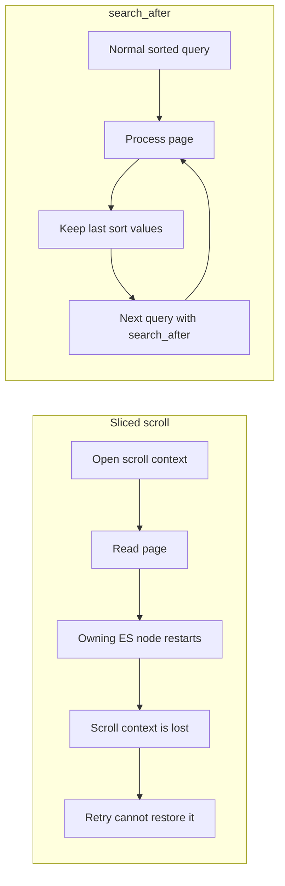

# When Elasticsearch forgot my scroll context

The migration read historical Elasticsearch data a page at a time, then
wrote it to ADLS as Parquet for the transformation and ingestion stages.
Large indices could take a day or two to finish. Our first approach used
sliced scrolls so several readers could fetch different parts of an index at
once.

The scroll contexts lived on Elasticsearch nodes. When one of those nodes
restarted, a request could fail with HTTP 500 or
`search_context_missing`; retrying the same scroll ID could not restore a
context that no longer existed. We tried changing slice counts, batch sizes,
delays, and retries. Those adjustments helped with pressure and diagnosis,
but they did not solve the lost-context problem. Losing a context late in a
large index could mean repeating a day of work because the durable checkpoint
advanced only after the whole index finished.

I proposed and implemented a pluggable `search_after` path. Each query used
a stable sort on creation time and record ID. After processing a page, the
reader used the last record's sort values in the next query. That replaced
the long-lived server-side scroll context with a sequence of ordinary
requests, so an Elasticsearch node restart no longer invalidated the
pagination state.

I also split the requested time range into non-overlapping windows and used
adaptive batch sizes: batches could grow when reads were healthy and back off
when the source was under pressure. Within an instance, four readers fetched
from Elasticsearch and twelve writers saved to ADLS, with a bounded queue
between them. The queue let the two sides work concurrently without allowing
fast readers to accumulate unlimited data in memory. We usually ran three
instances per deployment, and six in a few less common cases.

Throughput was around 12–18 million records per hour per instance. Large
indices often held 300–400 million records and took one or two days to
process. For a monthly run, I could divide the time range into roughly four
windows and run them in parallel.

There was an important limit: the page cursor lived in memory, while the
durable checkpoint still advanced only when an entire index finished. An
Elasticsearch node restart no longer destroyed the cursor, but restarting
the migration application during an index could still make that index replay
from its last completed checkpoint. The downstream ADLS-to-Kusto path already
handled deduplication for replayed records.
