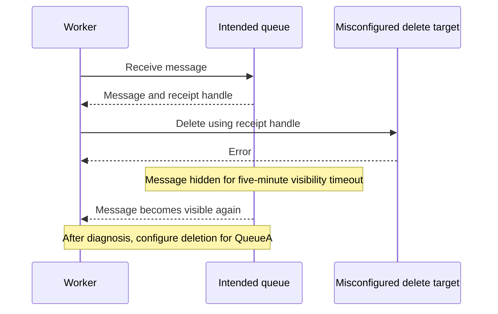

# The SQS message that came back five minutes later

At Expedia, I debugged a production bug where a message was processed and
then showed up again exactly five minutes later.

I found the problem through an error in Splunk. I followed that clue into the
code and configuration and found that the consumer was polling the right SQS
queue, but a misplaced environment variable sent its delete request to a
different queue. SQS rejected the delete because the receipt handle belonged
to the queue that had delivered the message, not the queue named in the
delete request. The original queue therefore never got the acknowledgment.
It hid the message for its five-minute visibility timeout, then made it
available to another worker. With the receive limit set to 2, it eventually
went to the dead-letter queue.

I fixed the queue configuration so the consumer deleted from the same queue
it had polled. After that, a successful processing attempt also removed the
message instead of letting it reappear five minutes later.
