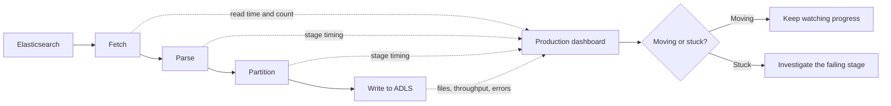

# Watching the migration while it ran

I was accountable for the Elasticsearch-to-ADLS download job and owned that
flow. The job pulled historical data out of Elasticsearch and wrote it to
ADLS for the next stage of the migration. A run could span many indices and
last for days, so I watched an internal production dashboard to answer a
simple question: was each deployment still making useful progress?

I tracked completed indices, records read and saved, files written, transfer
rate, and application errors. The dashboard also let me compare time spent
fetching from Elasticsearch with parsing, partitioning, and writing to
storage. That helped me tell the difference between a job that was steadily
working through a large index and one that had stopped or slowed at a
particular stage.

Some deployments ran long enough that I stayed close to the dashboard.
Sometimes I chose the office gym over the home gym so I could check progress
between sets and get back to an error quickly. I remember that detail because
the job was mine to own, not something I could just start and forget.
